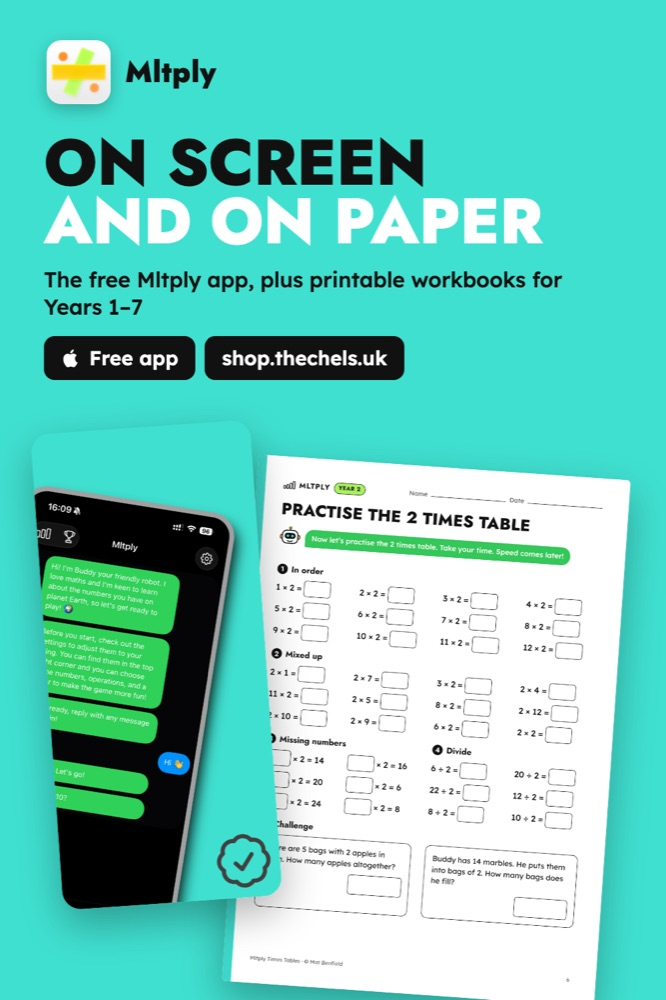
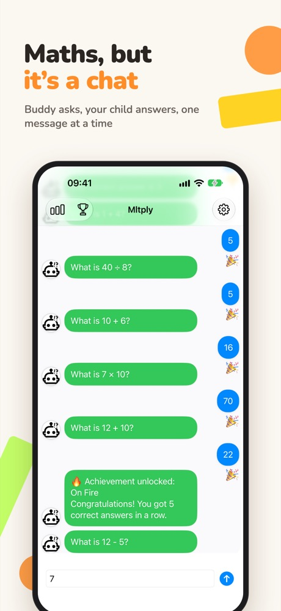

# Mltply: free maths app and printable workbooks

**Mltply** is a complete times tables practice package for primary-age children: a **free iPhone app** for daily practice with Buddy the robot, plus **printable maths workbooks** for Years 1 to 7, with every answer worked out. Made for parents practising at home and teachers in the classroom.

This repository is the marketing website, live at **[mltply.thechels.uk](https://mltply.thechels.uk/)**.

## Printable maths workbooks

Instant PDF downloads that follow England's national curriculum, starring Buddy the robot from the app:

- Times tables 2 to 12 and division 2 to 12
- Addition and subtraction, and fractions
- Squares, cubes and roots, plus KS2 SATs arithmetic practice papers
- Every answer worked out and checked by computer

Get them from the [Gumroad store](https://shop.thechels.uk) or the [Etsy shop](https://www.etsy.com/shop/thechelsuk) (single workbooks from £4.79, the Years 1 to 7 bundle £17.99).

## The free app

Buddy asks, your child answers, in a chat. Free on the [App Store](https://apps.apple.com/gb/app/mltply-math-quiz-for-kids/id6747147316), with no ads, no sign-up, no in-app purchases and no data sharing. [Privacy policy](https://thechels.uk/app/privacy).

- **It feels like texting a friend**, so practice is less intimidating than a worksheet.
- **Times tables 1 to 12**: choose the tables, in order or shuffled, with addition, subtraction, multiplication and division.
- **Streaks and achievements** keep motivation high, and a timer adds a challenge, with levels from Starter to GOAT.
- **Open source**: the code is on [GitHub](https://github.com/thechelsuk/com.uk.thechels.mltply).

## About this site

A plain HTML and CSS site with no build step, deployed to GitHub Pages by the workflow in `.github/workflows/pages.yml`. Preview it locally with `python3 -m http.server`.

More about the app: [thechels.uk/projects/mltply](https://thechels.uk/projects/mltply).
